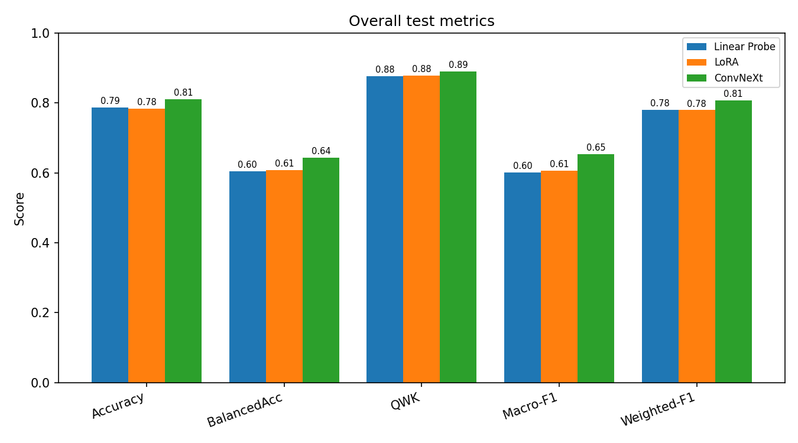
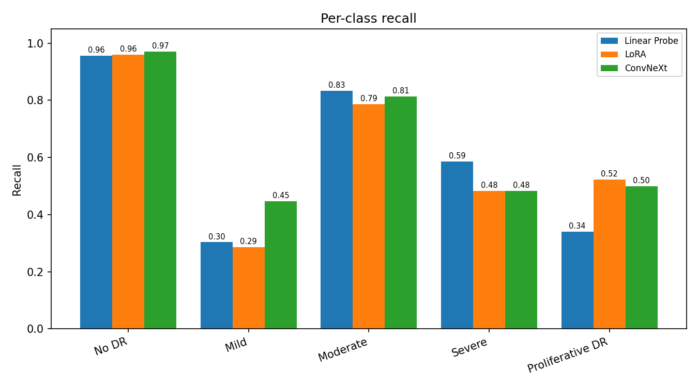
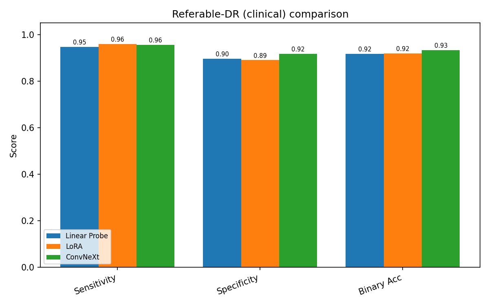
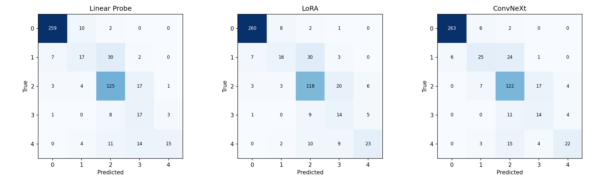

# Diabetic Retinopathy Grading: Modern CNN vs. Retinal Foundation Model

### 🔗 [**Try the Live Demo →**](https://huggingface.co/spaces/Srishanth3/dr-screening)


A reproducible study comparing three transfer-learning strategies for **5-class diabetic retinopathy (DR) severity grading** on APTOS 2019: a fully fine-tuned **ConvNeXt V2-Tiny** CNN versus a 300M-parameter retinal foundation model (**RETFound**) adapted two ways — **linear probing** and **LoRA** — reaching **0.89 quadratic weighted kappa** and **~96% referral sensitivity** on a locked test set, all on an **8 GB laptop GPU**.

## Highlights

- **Three adaptation strategies compared** on an identical, seed-fixed split.
- **Best QWK: 0.8906** (ConvNeXt, full fine-tune); RETFound+LoRA reached **0.8790** using **24× fewer trainable parameters**.
- **Clinical referable-DR screening: up to 96.0% sensitivity, 97% NPV** — only 9/223 sick patients missed.
- **Two-lens evaluation:** strict 5-class grading *and* clinically meaningful referable-DR (binary).
- Honest reporting of a **validation-to-test generalization gap** and hardware-constrained comparison.

## Problem & Motivation

Diabetic retinopathy is a leading cause of preventable blindness and is often **asymptomatic** in early stages. Effective care depends on **regular screening and accurate severity staging**, but there are far too few ophthalmologists to manually grade the millions of retinal photographs taken each year — especially in low-resource settings. Automated grading from color fundus photographs can help triage patients who need specialist care.

## Dataset

- **APTOS 2019 Blindness Detection** (color fundus photography), 3,662 labeled images.
- **5-class ordinal severity scale:** 0 No DR, 1 Mild, 2 Moderate, 3 Severe, 4 Proliferative DR (PDR).
- **Class imbalance:** No DR ≈ 49% of images; Severe and PDR are rare (~2–8%).

### Split

A **stratified, seed-42** split preserving class proportions:

| Split | Images |
|---|---|
| Train | 2,562 |
| Validation | 550 |
| Test | 550 |

The **test set is locked** and evaluated exactly once per model to give an unbiased generalization estimate.

## Preprocessing & Augmentation

- Resize to **224×224**, **ImageNet mean/std normalization**.
- **Training augmentation:** random flips/rotations (applied on-the-fly).
- **Inverse-frequency class weights** in the loss to counter class imbalance.

## Methods

Three transfer-learning strategies, all evaluated on the identical split:

| Model | Backbone | Adaptation | Trainable params |
|---|---|---|---|
| **ConvNeXt V2-Tiny** | ImageNet-pretrained CNN | Full / two-phase fine-tune | 27,870,341 |
| **RETFound — Linear Probe** | ViT-Large/16 (MAE, retinal FM) | Frozen backbone + linear head | 5,125 |
| **RETFound — LoRA** | ViT-Large/16 (MAE, retinal FM) | Frozen backbone + low-rank adapters | 1,184,773 |

- **RETFound** uses the `RETFound_mae_natureCFP` checkpoint (color fundus pretraining), chosen to match the APTOS modality.
- **LoRA** config: rank `r=8`, `alpha=16`, dropout `0.05`, adapters injected into all attention `qkv` and `proj` layers.

## Training Details

- **Optimizer:** AdamW; **loss:** class-weighted cross-entropy with label smoothing 0.05.
- **Scheduler:** ReduceLROnPlateau (factor 0.5, patience 2) on validation QWK.
- **Early stopping** on validation QWK; **mixed precision (fp16)**.
- **Model selection by validation Quadratic Weighted Kappa** (not accuracy), because the labels are ordinal.
- **Hardware:** NVIDIA RTX 4060 Laptop GPU (8 GB), 16 GB RAM, CUDA 12.1.

## Evaluation Methodology (Two Lenses)

1. **Strict 5-class grading** — accuracy, balanced accuracy, **QWK**, macro-F1, weighted-F1, per-class metrics, confusion matrix.
2. **Clinical referable-DR screening** — grades collapsed to a binary decision (**grade ≥ 2 = "needs a specialist"**), reporting **sensitivity, specificity, PPV, NPV** — how FDA-cleared DR systems are actually measured.

## Results (Held-out test set, 550 images)

### Overall 5-class metrics

| Metric | RETFound Linear Probe | RETFound LoRA | ConvNeXt V2-Tiny |
|---|---|---|---|
| Accuracy | 0.7873 | 0.7836 | **0.8109** |
| Balanced accuracy | 0.6039 | 0.6075 | **0.6426** |
| **Quadratic Weighted Kappa** | 0.8766 | 0.8790 | **0.8906** |
| Macro-F1 | 0.6009 | 0.6068 | **0.6536** |
| Weighted-F1 | 0.7798 | 0.7794 | **0.8081** |
| Trainable params | 5,125 | 1,184,773 | 27,870,341 |

### Per-class recall

| Class | Linear Probe | LoRA | ConvNeXt |
|---|---|---|---|
| No DR | 0.9557 | 0.9594 | **0.9705** |
| Mild | 0.3036 | 0.2857 | **0.4464** |
| Moderate | **0.8333** | 0.7867 | 0.8133 |
| Severe | **0.5862** | 0.4828 | 0.4828 |
| Proliferative DR | 0.3409 | **0.5227** | 0.5000 |

### Clinical referable-DR (grade ≥ 2)

| Metric | Linear Probe | LoRA | ConvNeXt |
|---|---|---|---|
| Sensitivity | 0.9462 | **0.9596** | 0.9552 |
| Specificity | 0.8960 | 0.8899 | **0.9174** |
| PPV | 0.8612 | 0.8560 | **0.8875** |
| NPV | 0.9607 | **0.9700** | 0.9677 |
| Binary accuracy | 0.9164 | 0.9182 | **0.9327** |
| Sick patients missed (FN) | 12 | **9** | 10 |

Comparison figures and confusion matrices are generated in `reports/`:






## Key Findings

- **ConvNeXt (full fine-tune) is strongest overall** — highest accuracy, balanced accuracy, QWK, and macro-F1.
- **RETFound + LoRA is the most parameter-efficient and the safest screener** — within 0.012 QWK of ConvNeXt while training **24× fewer parameters** on a frozen 300M backbone, with the **highest sensitivity and NPV** and the **fewest missed sick patients**.
- **Honest caveat — validation/test gap:** LoRA's validation QWK (0.9036) did not fully transfer to the test set (0.8790), a reminder of validation-set optimism on a small dataset.
- **This is a comparison of adaptation strategies under a hardware constraint** (RETFound was linear-probed / LoRA-tuned rather than fully fine-tuned due to the 8 GB GPU), **not** a claim that one architecture is universally superior.

## Project Structure

```
diabetic-retinopathy-detection/
├── src/
│   ├── dataset.py                 # APTOS loading, split, augmentation, class weights
│   ├── model.py                   # ConvNeXt V2-Tiny
│   ├── train.py                   # ConvNeXt training
│   ├── evaluate_convnext.py       # ConvNeXt test evaluation
│   ├── retfound_model.py          # RETFound builder + timm-compat forward
│   ├── train_retfound.py          # RETFound linear-probe training
│   ├── evaluate_retfound.py       # RETFound linear-probe evaluation
│   ├── lora.py                    # LoRA adapter implementation
│   ├── train_retfound_lora.py     # RETFound LoRA training
│   ├── evaluate_retfound_lora.py  # RETFound LoRA evaluation (5-class + referable)
│   └── compare_models.py          # 3-way comparison tables + figures
├── checkpoints/                   # model checkpoints & test results (gitignored large files)
├── reports/                       # comparison CSVs & figures
├── external/RETFound/             # official RETFound source (gitignored)
└── weights/                       # RETFound checkpoint (gitignored)
```

## Setup

Requires **Python 3.11**, an NVIDIA GPU with CUDA 12.1.

```bash
python -m venv .venv
# Windows
.venv\Scripts\activate

pip install torch==2.5.1+cu121 torchvision==0.20.1+cu121 --index-url https://download.pytorch.org/whl/cu121
pip install timm scikit-learn pandas matplotlib numpy datasets
```

RETFound requires the official source and the color-fundus checkpoint (see the RETFound repository). The weight file and `external/RETFound/` are **not** committed (see Licensing).

## Reproduce

```bash
# Train
python -m src.train                                              # ConvNeXt V2-Tiny
python -m src.train_retfound --epochs 20 --batch-size 8 --patience 5
python -m src.train_retfound_lora --epochs 30 --batch-size 4 --patience 6

# Evaluate on the locked test set
python -m src.evaluate_convnext
python -m src.evaluate_retfound
python -m src.evaluate_retfound_lora

# 3-way comparison (tables + figures in reports/)
python -m src.compare_models
```

## Limitations

- **Single dataset** (APTOS 2019); no external-dataset validation yet.
- **Validation/test gap** observed for LoRA — results should be read on the test set.
- **Unequal optimization budgets:** ConvNeXt was fully fine-tuned; RETFound was adapted with linear probing / LoRA due to the 8 GB GPU — so this compares *adaptation strategies*, not architectures in isolation.
- **Label noise** inherent to APTOS caps achievable accuracy.

## Future Work

- External validation on **Messidor-2** (domain-shift test) and scale-up on **EyePACS**.
- **Higher input resolution** (384–512) to capture small lesions.
- **Grad-CAM** explainability heatmaps and a lightweight inference demo.
- Partial fine-tuning of RETFound for a fully budget-matched comparison.

## Licensing & Attribution

- **APTOS 2019** data: used under its original Kaggle/APTOS terms.
- **RETFound weights: CC BY-NC 4.0 (non-commercial).** The checkpoint and `external/RETFound/` are **not redistributed** in this repository.
- This project is for **research and educational** use.

## References

- Zhou et al., *A foundation model for generalizable disease detection from retinal images*, Nature (2023). (RETFound)
- Woo et al., *ConvNeXt V2* (2023).
- Hu et al., *LoRA: Low-Rank Adaptation of Large Language Models*, ICLR (2022).
- He et al., *Masked Autoencoders Are Scalable Vision Learners* (2022).
- APTOS 2019 Blindness Detection, Kaggle.

## ⚠️ Disclaimer

This project is a research and educational demonstration. It is **not a medical device** and must **not** be used for clinical diagnosis or treatment decisions.

---

*Author: [Srishanth] 
